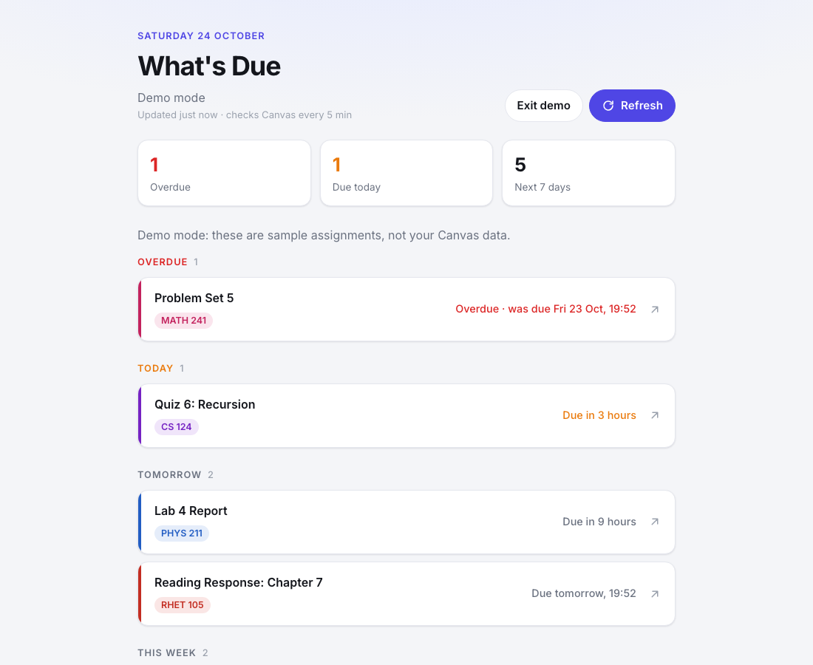

# What's Due: Canvas Assignment Dashboard

A web app that pulls assignments from every course in Canvas into one list, grouped
into Overdue / Today / Tomorrow / This week / Later, soonest due first, so nothing slips
by. I built it because keeping track of assignments across all my classes was a real
struggle, and almost all of them post work on Canvas.



## Features

- **One list across all courses**, each card labeled by course and linked to the
  assignment in Canvas. Overdue work is highlighted in red.
- **Log in with your own Canvas calendar link.** Each person sees their own assignments.
  The app greets you by name and keeps you logged in across restarts until you log out.
- **Stays current:** re-checks Canvas every 5 minutes and whenever you return to the tab.
- **Demo mode** with sample data, for trying it without a Canvas account.

## How it works

- **Front end:** TypeScript and plain DOM, bundled with Vite.
- **Server:** Node + Express in TypeScript. It fetches the user's Canvas calendar feed
  (iCalendar `.ics`) and parses it into assignments. Browsers can't call Canvas directly
  (CORS), and this keeps the user's private feed link out of the page.
- **Why the calendar feed:** my university doesn't let students create Canvas API
  tokens, so the app reads the per-user calendar feed instead.
- **Logins:** feed links are encrypted with AES-256-GCM and stored on the server. The
  browser holds only a random session ID in an `httpOnly` cookie. The server accepts
  only Canvas feed URLs on the configured Canvas host.
- **Tests:** Vitest, covering feed parsing, grouping and sorting, due-date labels, and
  the login API against a fake Canvas server.

## Run it

Needs [Node.js](https://nodejs.org) (LTS).

```bash
npm install
npm run dev
```

Open http://localhost:5173. Paste your Canvas calendar link (Canvas → **Calendar** →
**Calendar Feed**, bottom right), or open http://localhost:5173/?demo to see sample data.

To use a Canvas other than Illinois, copy `.env.example` to `.env` and change
`CANVAS_BASE_URL`.

## Test and check

```bash
npm test
npm run typecheck
npm run format
```
